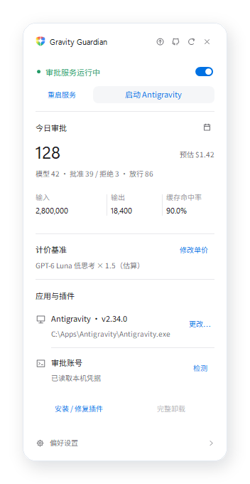
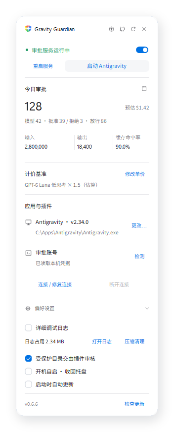

<div align="center">


# Gravity Guardian

### Informed approvals. Fewer interruptions.

Tool approvals for Antigravity on Windows.<br>
Bundled Codex Native Guardian, review feedback, and usage statistics.


**[Download for Windows](https://github.com/CarlosZ16420/gravity-guardian/releases/latest)** · [中文](README.md) · [Report an issue](https://github.com/CarlosZ16420/gravity-guardian/issues)

</div>

Guardian reviews Antigravity tool requests using your instructions and project rules. Antigravity executes actions and retains its native permission constraints. **No separate Codex CLI installation is needed to run the plugin.**

[](assets/readme/panel-showcase.zh-CN.png)

> This guide and the screenshots describe the **0.6.7 source**. Available downloads are listed in [Releases](https://github.com/CarlosZ16420/gravity-guardian/releases/latest); follow the matching release instructions for older versions. Screenshots use synthetic data and status.

## Quick start

1. Open Antigravity at least once on Windows x64. Sign in to Codex as the same Windows user with an account that can access `codex-auto-review`.
2. Download a release ZIP and **fully extract it to a writable folder**. Exit Antigravity, then open `GravityGuardian.exe`.
3. In Portable, choose **「连接 / 修复连接」** (Connect / Repair). In Standalone or Lite, choose **「安装 / 修复插件」** (Install / Repair). Reopen Antigravity.

The 0.6.7 source supports three editions with the same review engine:

| Edition | Runtime and data |
| --- | --- |
| **Portable** · ZIP name contains `-portable-` | Bundles the runtime; program, settings, and approval data stay in the extracted folder. |
| **Standalone** · no edition suffix | Bundles the runtime; installs the plugin and data under the current user. |
| **Lite** · ZIP name contains `-lite-` | Like Standalone, but requires an installed x64 .NET 10 runtime. |

Verify ZIPs against `checksums.sha256`. For Lite, install the runtime with `winget install Microsoft.DotNet.Runtime.10 --architecture x64`. Fully exit Antigravity before connecting, switching editions, or upgrading. See the [portable guide](docs/portable.md).

<details>
<summary>View the Portable panel</summary>

[](assets/readme/portable-showcase.zh-CN.png)

</details>

## Features

- **Contextual reviews:** `codex-auto-review` evaluates requests and returns outcomes and denial reasons to Antigravity.
- **Your final say:** a denial with high user authorization opens Antigravity's native confirmation prompt by default.
- **Takeover switch:** pause plugin review for new requests and return to Antigravity's native permission rules.
- **Usage at a glance:** today, the past seven days, or custom dates; approvals, input/output tokens, cache hit rate, and configurable cost estimates.
- **Local controls:** install/repair, credential detection, logging and cleanup, protected-directory review delegation, and verified update packages.

Reviews send the required context to Codex. Detailed logs are off by default; when enabled, local logs may contain paths, conversation content, and tool arguments. The panel UI is in Simplified Chinese.

## Common questions

**Are local credentials enough?** The account must also have access to `codex-auto-review`. Use 「审批账号 → 检测」 to check credentials; detection does not guarantee model access. See the [validation record](docs/guardian-0.172.0-validation.md).

**How do I update or remove it?** The panel checks and downloads verified updates; upgrades preserve settings and history. Portable's 「断开连接」 disconnects Antigravity and keeps local data. Exit related processes before deleting the folder. Standalone/Lite's 「完整卸载」 removes the plugin, startup entry, and all local logs, statistics, settings, caches, and backups. Fully exit Antigravity first.

To switch from Portable to an installed edition: exit Antigravity, click 「断开连接」 in Portable, confirm the panel has exited, then run the installer. Closing the window or exiting the tray does not disconnect it. Keep the Portable folder as a backup if needed; its history is not automatically merged into the installed edition.

## Development and license

Build on Windows x64 with PowerShell 7, .NET 10 SDK, Node.js 22+, stable Rust, and MSVC C++ tools:

```powershell
.\scripts\Update-Local.ps1 -BuildOnly   # Incremental build without installation
```

[Build and release validation](docs/packaging-runbook.md) · [Changelog](CHANGELOG.md) · [Apache-2.0](LICENSE) · [Third-party notices](NOTICE)

Gravity Guardian is an independent open-source project. Include the version and reproduction steps in issue reports, with private paths, credentials, and conversations removed.

## Community

- [LINUX DO](https://linux.do/)
- [Hamster Archiver](https://github.com/CarlosZ16420/hamster-archiver)
- [Data Traffic Ledger](https://github.com/CarlosZ16420/DataTrafficLedger)
