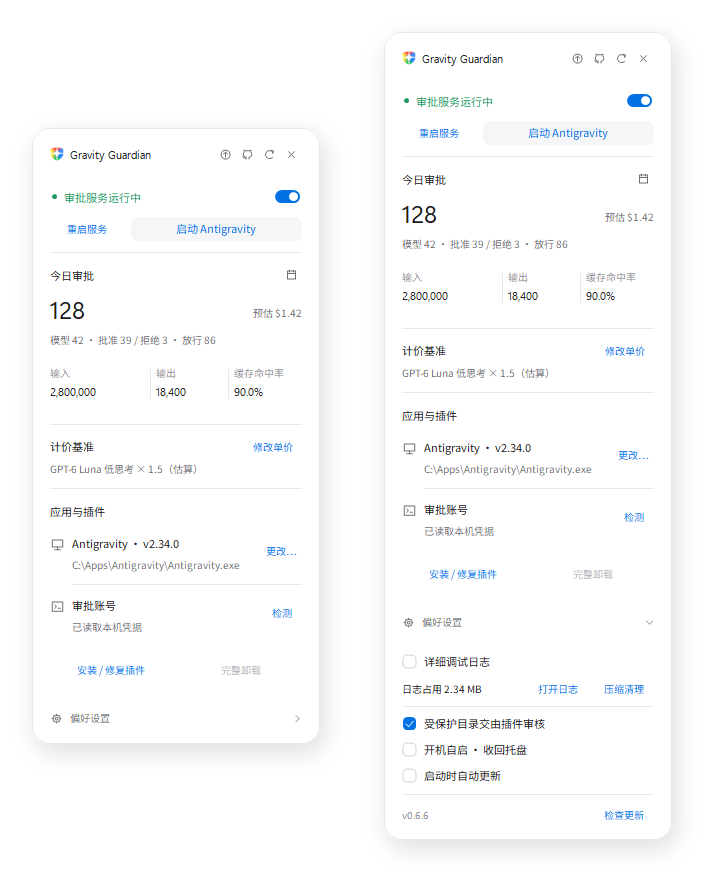
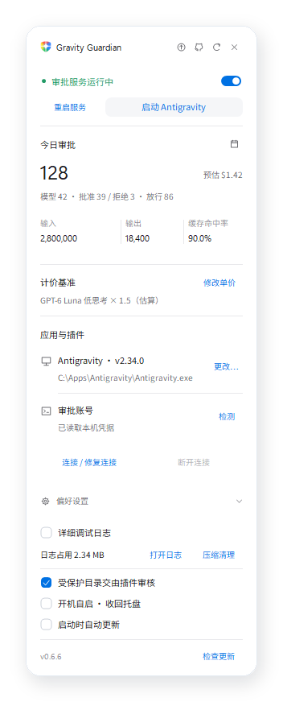

<div align="center">


# Gravity Guardian

### 审批有依据，工作少打断。

Windows 上的 Antigravity 工具审批助手。<br>
内置 Codex Native Guardian，审核请求、反馈原因、统计用量。


**[下载 Windows 版](https://github.com/CarlosZ16420/gravity-guardian/releases/latest)** · [English](README.en.md) · [反馈问题](https://github.com/CarlosZ16420/gravity-guardian/issues)

[快速开始](#快速开始) · [功能介绍](#功能介绍) · [常见问题](#常见问题) · [开发与开源](#开发与开源)

</div>

Antigravity 发起工具请求，Guardian 结合用户指令与项目规则进行审核，再由 Antigravity 执行并保留原生权限约束。**插件运行无需额外安装 Codex CLI。**

[](assets/readme/panel-showcase.zh-CN.png)

> 本文与截图对应 **0.6.6 源码**，截图使用虚构统计与状态。可下载版本以 [Releases](https://github.com/CarlosZ16420/gravity-guardian/releases/latest) 为准；旧版请按对应发行说明安装。

## 快速开始

1. 在 Windows x64 上至少打开一次 Antigravity，并在同一 Windows 用户下完成 Codex 登录；账号需有权使用 `codex-auto-review`。
2. 下载发行 ZIP，**完整解压到可写文件夹**。退出 Antigravity，打开 `GravityGuardian.exe`。
3. Portable 点击 **「连接 / 修复连接」**；Standalone / Lite 点击 **「安装 / 修复插件」**。完成后重新打开 Antigravity。

0.6.6 提供三种包型，使用相同的审核内核：

| 包型 | 如何选择 |
| --- | --- |
| **Portable 免安装版** · 文件名带 `-portable-` | 自带运行时；程序、配置和审批数据集中在解压目录，方便备份。 |
| **Standalone** · 文件名无额外包型后缀 | 自带运行时；将插件和数据安装到当前用户目录。 |
| **Lite** · 文件名带 `-lite-` | 使用系统已安装的 x64 .NET 10，其余与 Standalone 相同。 |

下载后可用同页的 `checksums.sha256` 校验 ZIP。Lite 缺少运行时时，可执行 `winget install Microsoft.DotNet.Runtime.10 --architecture x64`。连接、切换包型或升级前先完全退出 Antigravity。[免安装版说明](docs/portable.md)

<details>
<summary>查看免安装版界面</summary>

[](assets/readme/portable-showcase.zh-CN.png)

</details>

## 功能介绍

| 你需要什么 | Guardian 如何帮助你 |
| --- | --- |
| **按上下文审核** | 调用 `codex-auto-review` 审核工具请求，向 Antigravity 返回结果与拒绝原因。 |
| **明确授权后仍被拒绝** | 默认转为 Antigravity 原生人工确认，由你决定是否执行。 |
| **随时暂停接管** | 托盘面板一键切换，新请求恢复由 Antigravity 原生权限规则处理。 |
| **看清审批消耗** | 查看今日、近 7 日及自定义日期的审批统计、输入与输出 Token、缓存命中率和估算费用。 |
| **集中管理** | 安装修复、凭据检测、日志开关与清理、受保护目录审核委派、校验更新包。 |

模型审核会向 Codex 服务发送所需上下文。详细日志默认关闭，启用后保存在本机，可能包含路径、对话和工具参数。费用为可配置估算。

## 常见问题

<details>
<summary>有 Codex 登录就一定能用吗？</summary>

还需要账号有权访问 `codex-auto-review`。面板「审批账号 → 检测」可检查本机凭据；检测到凭据不代表模型一定可用。支持的登录配置见[验收记录](docs/guardian-0.172.0-validation.md)。

</details>

<details>
<summary>如何更新或卸载？</summary>

面板可检查并下载校验后的更新包。升级保留设置与历史审批统计；手动切换包型时，完整解压目标 ZIP，再从新目录安装或连接。

Portable 点击「断开连接」会移除 Antigravity 登记并保留本文件夹数据，退出相关程序后可自行删除文件夹。Standalone / Lite 点击「完整卸载」会移除插件、开机启动项，并永久删除本地审批日志、统计、设置、缓存和备份。操作前先完全退出 Antigravity。

</details>

## 开发与开源

构建需要 Windows x64、PowerShell 7、.NET 10 SDK、Node.js 22+、Rust stable 和 MSVC C++ 构建工具。

```powershell
.\scripts\Update-Local.ps1 -BuildOnly   # 增量构建，不安装到本机
```

[构建与发行验收](docs/packaging-runbook.md) · [变更记录](CHANGELOG.md) · [Apache-2.0](LICENSE) · [第三方声明](NOTICE)

Gravity Guardian 是独立的开源项目。反馈请附版本、复现步骤和错误信息，并隐去私人路径、凭据及原始对话。

## 友链

- [LINUX DO — 新的理想型社区](https://linux.do/)
- [仓鼠症大结局 Hamster Archiver](https://github.com/CarlosZ16420/hamster-archiver)
- [流量账本 Data Traffic Ledger](https://github.com/CarlosZ16420/DataTrafficLedger)
